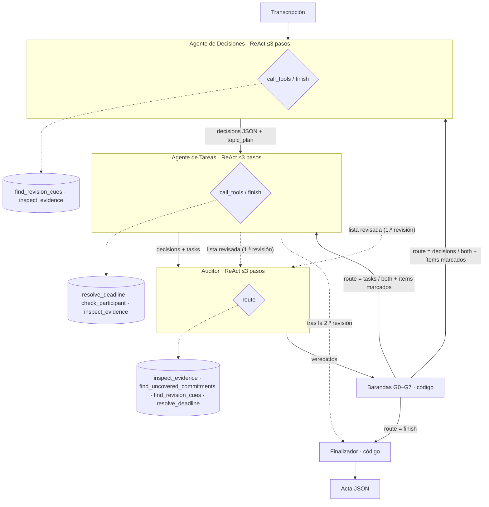
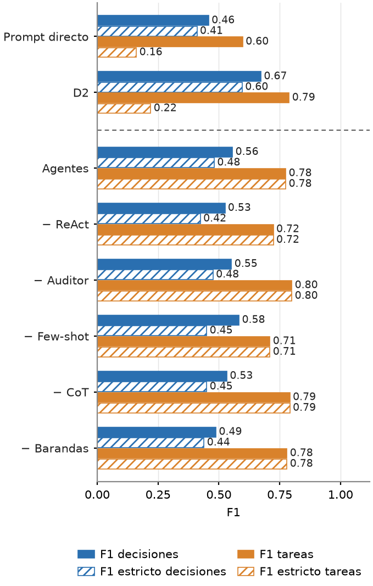

# Entregable 3 · Actas de reunión con agentes

> Inteligencia Artificial Generativa (580694) · Primavera 2026 · Benjamín Alvear, Xavier Godoy, Eduardo Ruiz, Damián Vera

El sistema del Entregable 2 (Ministral 3B + JSON restringido + herramientas determinísticas, en dos pasadas fijas) se reconstruye como **tres agentes que deciden** qué hacer: llamar herramientas, devolver trabajo a otro agente o terminar. Se usa el mismo modelo, las mismas 10 reuniones de test y el mismo evaluador del D2.

| Recurso | Enlace |
|---|---|
| Documento técnico (1 página, LaTeX) | [`Deliverable_3.pdf`](../Deliverable_3.pdf) · [fuente](paper/D3.tex) |
| Video (≤ 3 min) | [YouTube](https://www.youtube.com/watch?v=pexxeQTg9Mk) · [guion](docs/video_script.md) · [traza de la corrida grabada](runs/video/) |
| Notebook de Colab | [`notebooks/D3_Colab.ipynb`](notebooks/D3_Colab.ipynb) · [abrir en Colab](https://colab.research.google.com/github/benjaminnalvear-dev/genai-vio-meeting-minutes/blob/main/deliverable3/notebooks/D3_Colab.ipynb) |
| Traza del video (M01) | [`runs/test/traces/full/M01.jsonl`](runs/test/traces/full/M01.jsonl) |
| Traza del caso de falla (M09) | [`runs/test/traces/full/M09.jsonl`](runs/test/traces/full/M09.jsonl) |
| Resultados agregados | [`runs/test/results/summary.json`](runs/test/results/summary.json) |
| Prompts versionados | [`prompts/`](prompts/) · [registro de cambios](prompts/CHANGELOG.md) |

## 1. El problema y por qué es difícil

Una reunión en español se transforma en un **acta JSON**: las **decisiones** (con estado `final`, `superseded`, `rejected` o `pending`, y qué decisión reemplaza a cuál) y las **tareas** (responsable, plazo en fecha ISO y condición). Cada ítem cita el turno (`evidence_id`) que lo respalda.

El D2 dejó cuatro errores diagnosticados (se llaman E1–E4 para no confundirlos con la métrica F1; en el [registro de prompts](prompts/CHANGELOG.md) aparecen como F1–F4):

| | Error del D2 | Dato del informe del D2 (test) |
|---|---|---|
| E1 | Estados de decisión no finales (reemplazos, rechazos, pendientes) | El D2 encontró 10 de 30 |
| E2 | Plazos relativos mal calculados o inventados | 12 de 39 correctos |
| E3 | Tareas confirmadas marcadas como `pending` | 47 de 56 |
| E4 | Nadie verifica que la cita respalde el ítem | Omisiones heredadas |

**Por qué el benchmark es difícil.** Las 10 reuniones de test son diálogo natural: 347 turnos, 56 decisiones y 53 tareas. Solo 26 de las 56 decisiones son un "final" directo. El resto son trampas:

- 11 reemplazadas, 11 rechazadas y 8 pendientes;
- 20 temas revisados durante la reunión, con cadenas de hasta 3 propuestas y revisiones que en M01 llegan en promedio 20 turnos después;
- 10 decisiones y 15 tareas condicionales;
- 29 plazos relativos ("mañana", "el lunes") y 8 con hora;
- 24 menciones a personas ausentes que no pueden ser responsables.

Se calcula con `scripts/benchmark_difficulty.py`.

## 2. Arquitectura



| | Decisiones | Tareas | Auditor |
|---|---|---|---|
| **Rol** | Decisiones, su estado y cadenas de reemplazo | Tareas: responsable, plazo, condición, estado | Revisa el acta completa y elige la ruta |
| **Prompt** | [`decisions.v2`](prompts/decisions.v2.md) + [few-shot](prompts/fewshot/decisions.TR01.v2.md) | [`tasks.v2`](prompts/tasks.v2.md) + [few-shot](prompts/fewshot/tasks.TR01.md) | [`auditor.v3`](prompts/auditor.v3.md) |
| **Herramientas** | `find_revision_cues`, `inspect_evidence` | `resolve_deadline`, `check_participant`, `inspect_evidence` | `inspect_evidence`, `find_uncovered_commitments`, `find_revision_cues`, `resolve_deadline` |
| **Recibe** | Transcripción (y, al revisar, los ítems marcados) | Transcripción + decisiones | Transcripción + decisiones + tareas |
| **Entrega** | `topic_plan`, `decisions` | `tasks` | `verdicts` por ítem, `route` |
| **Se detiene** | `action = finish`, o al paso 3 | `action = finish`, o al paso 3 | `finish`, o tras 2 rondas de revisión |

**Qué deciden los agentes (por qué no es un pipeline).** En cada paso, Decisiones y Tareas eligen entre pedir herramientas (`call_tools`) o entregar (`finish`). El Auditor elige la ruta: `finish` (se termina), `decisions`, `tasks` o `both` (vuelve a uno o a ambos especialistas, con los ítems marcados). En test, los agentes hicieron 212 llamadas a herramientas, y la ruta varió entre reuniones: 3 terminaron tras la primera auditoría y 7 pasaron por 2 rondas de revisión. Las barandas rechazaron 41 de los 70 ítems que el Auditor marcó como erróneos y eliminaron 20 ítems duplicados. Después de una revisión, la lista corregida vuelve al Auditor; tras la segunda revisión pasa directo al Finalizador.

**Por qué esta división.** Decisiones y Tareas fallan de forma distinta (E1 contra E2/E3) y necesitan herramientas distintas. Separarlos le da a un modelo de 3B un prompt corto y enfocado. El Auditor cubre E4: ve el acta entera y detecta omisiones y contradicciones que ningún especialista ve.

**Nodos que son código, no agentes:**
- **Barandas G0–G7** ([`guards.py`](src/minutes_agents/guards.py)): descartan un veredicto del Auditor cuando las herramientas lo contradicen, por ejemplo un `wrong_deadline` cuyo día coincide con `resolve_deadline`. La ruta se recalcula con los veredictos aceptados.
- **Finalizador** ([`finalize.py`](src/minutes_agents/finalize.py)): ordena, renumera y aplica los chequeos mecánicos del D2. Además impide que una decisión y una tarea citen el mismo turno.

Las cinco herramientas son funciones Python determinísticas ([`tools.py`](src/minutes_agents/tools.py)). Tres vienen del D2 sin cambios.

## 3. Técnicas de prompting

Nombres según *The Prompt Report* (Schulhoff et al., 2024):

| Técnica | Dónde | Falla que ataca | Ablación |
|---|---|---|---|
| ReAct (razonar → herramienta → observar) | Los 3 agentes | E2 (plazos), E3, E4 | `no_react`: 1 paso, sin herramientas |
| Self-Criticism (Chain-of-Verification, Self-Refine) | Auditor + loop de revisión | E4 y omisiones | `no_auditor`: 0 rondas |
| Few-shot (1 reunión de train resuelta) | Decisiones, Tareas | E1 (cadenas), E3 | `no_fewshot` |
| Chain-of-Thought (`thought`, `topic_plan`) | Los 3 agentes | E1 | `no_cot` |
| Barandas determinísticas (código, no prompt) | Sobre el Auditor | Veredictos falsos del Auditor | `no_guards` |
| Role prompting, decomposition, salida estructurada (JSON restringido) | Todos | — | No ablacionadas (se declaran) |

Cada condición es un archivo en [`configs/`](configs/) que cambia **una sola** opción respecto de `full`.

## 4. Resultados (test, M01–M10, mismo evaluador del D2)

| Condición | F1 decisiones | F1 tareas | F1 estricto dec. | F1 estricto tareas | Estado correcto | Plazo correcto | Tiempo (s) |
|---|---:|---:|---:|---:|---:|---:|---:|
| Prompt directo (baseline) | 0,458 | 0,598 | 0,410 | 0,161 | 0,533 | 0,346 | 180 |
| D2 | **0,673** | 0,789 | **0,596** | 0,220 | 0,551 | 0,419 | 250 |
| **Agentes (full)** | 0,556 | 0,775 | 0,481 | 0,775 | 0,945 | 0,884 | 1358 |
| − ReAct | 0,525 | 0,724 | 0,424 | 0,724 | 0,918 | 0,833 | 1316 |
| − Auditor | 0,552 | **0,800** | 0,476 | **0,800** | 0,945 | 0,909 | 484 |
| − Few-shot | 0,583 | 0,710 | 0,450 | 0,710 | 0,890 | 0,868 | 1646 |
| − CoT | 0,533 | 0,792 | 0,450 | 0,792 | 0,932 | 0,929 | 676 |
| − Barandas | 0,488 | 0,780 | 0,439 | 0,780 | 0,961 | 0,891 | 1714 |



Cómo leer la tabla:
- **F1:** combina precisión y cobertura. Un ítem cuenta como encontrado si su texto se parece al menos 0,55 al de la rúbrica (criterio del D2).
- **F1 estricto:** además exige el estado correcto. Es la métrica que mide E1 y E3.
- **Estado y plazo correctos:** se calculan sobre los ítems emparejados.
- **Tiempo:** suma de inferencia por paso en GPU T4.

Qué muestran los resultados:
- **Tareas, estados y plazos mejoran mucho:**
  - F1 estricto de tareas: 0,22 → 0,78. El D2 dejaba 44 tareas en `pending`; el sistema, ninguna.
  - Plazos correctos: 42 % → 88 %. Los plazos inventados bajan de 11 a 3.
  - Comparando reunión por reunión con el D2, el sistema gana 7 de 10 en F1 estricto.
- **Decisiones empeoran:** F1 0,673 → 0,556. Gana en rechazos (encuentra 6 de 11, contra 2 del D2), pero pierde pendientes (1 de 8, contra 5) y condicionales (2 de 10, contra 8).
- **Las ablaciones explican la regresión:**
  - Sin few-shot, el F1 de decisiones sube a 0,583 y aparecen 5 de 8 pendientes. El ejemplo viene de train, que es de plantilla, y empuja a enunciados cortos (7 palabras en promedio, contra 16 del D2) que el emparejador por similitud castiga.
  - Las barandas son el componente que más aporta a decisiones: sin ellas, el F1 cae a 0,488.
  - El Auditor completo casi empata con no tenerlo y cuesta casi 3 veces más tiempo.

Los resultados por reunión y por tipo de trampa están en [`summary.json`](runs/test/results/summary.json) y en el mapa de calor [`trap_heatmap.png`](runs/test/figures/trap_heatmap.png).

## 5. Caso de falla: M09

M09 se eligió con un criterio fijado antes de la corrida: la reunión con el peor F1 estricto del sistema completo (0,50; F1 de decisiones 0,33). Traza: [`runs/test/traces/full/M09.jsonl`](runs/test/traces/full/M09.jsonl).

- **Cadena colapsada.** En u16 se propone mover la prueba al lunes 16, y en u17 queda fijada. El agente registró "lunes 16" como `final` en u16 y perdió la propuesta reemplazada.
- **Frontera decisión/tarea.** Tareas convirtió u17 ("Queda fijada la primera prueba…") en la tarea "Realizar la primera prueba técnica". Luego el Finalizador descartó la decisión de u17 porque citaba el mismo turno que esa tarea, y así se perdió la decisión correcta. En toda la corrida, en cambio, esa regla casi no mueve el F1 (ver §9).
- **Turnos repetidos.** u09/u10 y u12 repiten un mismo compromiso, y Tareas los registró dos veces cada uno (4 tareas por 2 reales).
- **Pendiente mal anclado.** "Definir activación futura" (u30) quedó fundido en una decisión `final` condicional en u28.

## 6. Cómo reproducir

### A. Lo que muestra el video (DEMO, ~5 min)

1. Abre el [notebook en Colab](https://colab.research.google.com/github/benjaminnalvear-dev/genai-vio-meeting-minutes/blob/main/deliverable3/notebooks/D3_Colab.ipynb).
2. Ve a `Entorno de ejecución → Cambiar tipo de entorno de ejecución → GPU T4`.
3. En la celda 1 deja `MODE = 'DEMO'` y `SOURCE = 'git'`. Con `git`, el código y el dataset (`GenAI Constrained+Tool use/Fine Tuning.zip`) salen del repositorio y no hay que subir nada. Para fijar la versión exacta usa `COMMIT = 'd36043b'`.
4. Ejecuta `Entorno de ejecución → Ejecutar todo`. Colab pide permiso para montar Google Drive, donde se guardan resultados y caché. Si prefieres no usar Drive, pon `PERSIST_DIR = '/content/d3_runs'`.
5. Qué muestra cada celda:
   - **Celda 2:** instala Ollama y descarga el modelo.
   - **Celda 5:** corre M01 con la condición `full`.
   - **Celda 6:** imprime la traza agente por agente: pensamientos, herramientas, veredictos, barandas y ruta.
   - **Celda 7:** muestra el acta final y las métricas.

### B. Experimento completo (FULL, ~3 h de GPU)

Igual que A, pero con `MODE = 'FULL'`: corre las 8 condiciones sobre M01–M10. La corrida se puede reanudar: si Colab se reinicia, vuelve a `Ejecutar todo` y sigue desde Drive. La celda 9 descarga `results/`, `traces/` y `figures/`, con la misma estructura que [`runs/`](runs/).

Desde una terminal, con Ollama y el modelo instalados:

```bash
pip install -r requirements.txt
python scripts/run_experiment.py --data "../GenAI Constrained+Tool use/Fine Tuning.zip" --split test --out runs/test/results --traces runs/test/traces
```

### C. Sin GPU

```bash
python -m pytest -q
python scripts/make_figures.py --summary runs/test/results/summary.json --out figuras
python scripts/benchmark_difficulty.py --data <carpeta con train/validation/test> --out dificultad
python scripts/replay_from_traces.py --data "../GenAI Constrained+Tool use/Fine Tuning.zip" --out posthoc.json
```

El PDF se compila con `python scripts/build_paper.py` (usa `latexmk`; con `--tectonic <ruta>` usa [Tectonic](https://tectonic-typesetting.github.io)). El script regenera las figuras en inglés y falla si el documento no tiene exactamente una página.

`pytest` corre 168 pruebas con un modelo simulado. Las órdenes siguientes regeneran las figuras y la tabla de dificultad, y repiten el diagnóstico post-hoc de §9, que vuelve a ejecutar el grafo con las respuestas del modelo guardadas en las trazas.

**Versión de la corrida reportada:**
- código: commit `d36043b`;
- Ollama: 0.40.11;
- modelo: `ministral-3:3b-instruct-2512-q4_K_M`, digest `f04aa1c738f6…`;
- parámetros: `temperature 0`, `seed 42`, `num_ctx 12288`, `num_predict 2400`.

Cada archivo de resultados guarda el hash SHA-256 de los prompts y la configuración usados. Si cambia un prompt, la reanudación recalcula esa reunión.

## 7. Cómo leer una traza

Cada línea de `runs/<split>/traces/<condición>/<reunión>.jsonl` es un evento:

| `agent` | Qué registra |
|---|---|
| `decisions` / `tasks` / `auditor` | Un paso del agente: `thought`, `action` (`call_tools`/`finish`), `tool_calls`, `observations` (lo que devolvieron las herramientas), `output`, `prompt_file`, `prompt_sha256`, tokens y segundos |
| `guard` | Un veredicto del Auditor descartado: `item_id`, `problem`, la baranda (`G0`–`G7`) y la razón |
| `router` | La ruta que pidió el Auditor (`auditor_route`), la que quedó tras las barandas (`route`), los ítems marcados y el siguiente nodo |
| `finalize` | Las acciones mecánicas del Finalizador y los conteos finales |

Ejemplo real de M01: el Auditor pidió revisar decisiones, la baranda G3 descartó su veredicto porque el turno citado sí dice "pendiente", y la ruta quedó en `finish`:

```json
{"agent": "guard", "item_id": "d01", "problem": "wrong_state", "guard": "G3", "reason": "pending respaldado: el turno citado dice \"pendiente\""}
{"agent": "router", "auditor_route": "decisions", "route": "finish", "flagged": [], "next": "finalize"}
```

## 8. Estructura

```
deliverable3/
├── prompts/        un archivo versionado por prompt (*.vN.md) + few-shot + CHANGELOG.md
├── configs/        una condición por archivo (full y las 5 ablaciones)
├── src/minutes_agents/
│   ├── agents/     Decisiones, Tareas, Auditor y el bucle ReAct común (base.py)
│   ├── graph.py    grafo LangGraph: nodos, aristas condicionales y paradas
│   ├── tools.py    herramientas determinísticas
│   ├── guards.py   barandas G0–G7
│   ├── finalize.py Finalizador
│   ├── evaluate.py evaluador del D2 (copia literal)
│   └── metrics.py  métricas extendidas (F1 estricto, trampas, plazos)
├── scripts/        run_experiment, make_figures, benchmark_difficulty, replay_from_traces, build_paper, package_for_colab
├── notebooks/      D3_Colab.ipynb
├── runs/           salidas de las corridas: test (8 condiciones) y validation
├── paper/          fuente LaTeX del documento de 1 página (D3.tex) y sus figuras en inglés
├── tests/          168 pruebas
└── docs/           especificación y plan de implementación
```

## 9. Desviaciones y limitaciones

- **Prompt directo y D2 se re-ejecutaron** con sus mismos prompts, en el mismo arnés y la misma versión de Ollama que los agentes, para que todas las condiciones corran igual. El D2 re-ejecutado obtiene 0,673 / 0,789 (F1 decisiones / tareas), contra 0,667 / 0,716 del informe del D2. Se compara contra la re-ejecución, que es la referencia más exigente en tareas.
- **Validation es un proxy débil.** Train y validation son de plantilla ("Hablante 0X", siempre 2 reemplazos, 1 rechazo y 1 pendiente); test es diálogo natural. En validation el sistema superó al D2 en F1 estricto en 10 de 10 reuniones (F1 de decisiones 0,915 contra 0,847), pero en test no se repitió en decisiones.
- **Cambios de diseño hechos mirando validation, nunca test:**
  - las barandas G0–G7 y `auditor.v3`, porque sin ellas el Auditor empeoraba el acta en 4 de 4 casos;
  - la regla anti-solapamiento del Finalizador.
  - Test se corrió una sola vez, con el commit `d36043b`.
- **La regla anti-solapamiento es neutra en test.** En las rúbricas de train y validation una decisión y una tarea nunca citan el mismo turno; en test pasa una vez.
  - Se hizo un diagnóstico post-hoc sobre la misma corrida, sin volver a llamar al modelo: el grafo se ejecuta de nuevo con las respuestas guardadas en las trazas. Con la regla, reproduce exactamente las 60 actas oficiales.
  - Sin la regla, el sistema completo recupera 4 decisiones correctas (como la de M09 u17), pero agrega 10 incorrectas. El F1 de decisiones pasa de 0,556 a 0,557, y el de tareas de 0,775 a 0,786.
  - **La regresión en decisiones no viene del Finalizador**, sino del agente de Decisiones.
  - Los números oficiales no cambian. Resultado completo, con las 5 ablaciones: [`posthoc_overlap_rule.json`](runs/test/posthoc_overlap_rule.json) (`scripts/replay_from_traces.py`).
- **Rúbricas de train y validation con errores conocidos:**
  - "antes del viernes" está anotado como fecha de la reunión + 3 días (43 casos en train, 8 en validation);
  - las decisiones reemplazadas citan el turno del reemplazo, mientras test cita el de la propuesta. Los prompts v2 siguen la convención de test, y por eso el few-shot `decisions.TR01.v2` se aparta a propósito de su rúbrica.
- **El few-shot de Tareas no tiene ejemplos sin plazo ni de "la tarde"**, porque train no los tiene. Queda solo como regla escrita en `tasks.v2`.
- **Técnicas no ablacionadas:** role prompting y JSON restringido. `no_cot` quita solo el CoT de la salida; el razonamiento escrito dentro del few-shot se mantiene.
- **Otros detalles del diseño:**
  - la última revisión no se vuelve a auditar;
  - las condiciones comparten la caché de llamadas idénticas, así que el tiempo reportado es la suma de la inferencia de cada paso.
