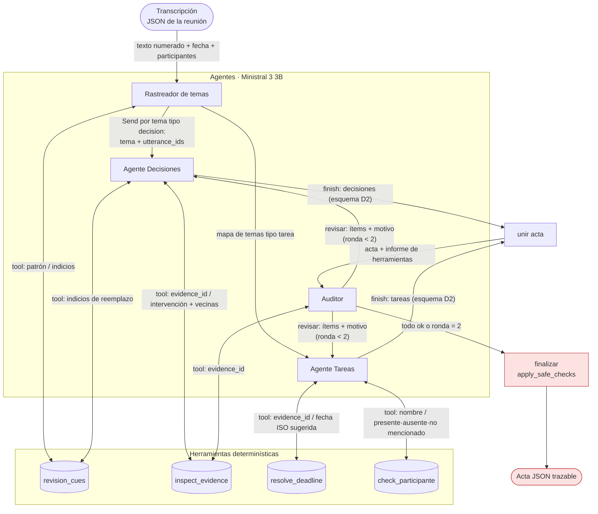

# D3 · Sistema multi-agente con LangGraph — diseño

Fecha: 2026-10-29 · Entrega: 2026-10-31 23:59 · Rama: `d3-multiagente`

## 1. Objetivo y alcance

Reconstruir la solución del Entregable 2 (Ministral 3 3B + JSON restringido + herramientas + segunda pasada)
como un sistema de **cuatro agentes** orquestado con **LangGraph**, sobre la misma tarea, el mismo modelo, las
mismas 10 reuniones de test y el mismo criterio de corrección. El sistema debe:

- tener agentes que **deciden** qué pasa después (llamar una herramienta, entregar a otro agente, revisar su
  salida o parar); una secuencia fija de prompts no cuenta;
- usar en todos los agentes `ministral-3:3b-instruct-2512-q4_K_M` (≤ 8B, open-weight) vía Ollama;
- guardar el prompt de cada agente en un archivo versionado fuera del código;
- registrar los mensajes entre agentes de cada reunión;
- medir baseline, D2, sistema completo y el sistema sin cada técnica clave, con el mismo evaluador.

Fuera de este spec: documento LaTeX de una página, guion del video y README final. Se hacen después con los
números.

## 2. Punto de partida (D2) y fallas que se atacan

Flujo D2 (`GenAI Constrained+Tool use/Ministral_Minutas_Colab.ipynb`): extracción con esquema → Python corre
siempre `inspect_evidence`, `resolve_deadline`, `revision_cues` → segunda pasada → `apply_safe_checks`. Es un
pipeline: no hay decisiones dentro.

Métricas de D2 `combined` en test (emparejamiento automático del notebook):

| Métrica | Valor | Falla |
|---|---:|---|
| Exactitud de estado (emparejados) | 0,50 | No sigue cadenas de reemplazo; confunde final/superseded/rejected/pending |
| Exactitud de plazo (emparejados) | 0,31 | Elige la expresión equivocada o resuelve mal la fecha |
| Precisión de tareas | 0,70 (39/56) | Anota tareas de más |
| Recall de decisiones | 0,63 (35/56) | Omite decisiones intermedias que después se reemplazan |

Cada agente se justifica por una de estas fallas.

## 3. Arquitectura



Condiciones de parada:
- Cada agente tiene un presupuesto de **3 llamadas a herramientas** (Rastreador: 1). Al agotarlo, el esquema
  de acción solo permite `finish`.
- El loop Auditor → especialista tiene **máximo 2 rondas**. En la ronda 2 el grafo va a `finalizar` aunque
  haya ítems marcados; esos quedan registrados en la traza.

### 3.1 Mecanismo de decisión

Cada paso de un agente es una llamada a Ollama con `format` = esquema de acción:

```json
{"action": "tool", "tool": "inspect_evidence", "args": {"evidence_id": "u14"}}
{"action": "finish", "output": { ... }}
```

El enum de `tool` y los argumentos válidos (IDs de intervención, nombres) se restringen por esquema, igual que
el `evidence_id` en D2. LangGraph enruta con `add_conditional_edges` según `action`. No se usa function
calling nativo: con 3B es poco confiable y el JSON restringido mantiene continuidad con D2.

Las llamadas al modelo usan `requests` directo a `/api/chat`, con los parámetros de D2: `temperature 0`,
`seed 42`, `num_ctx 12288`, `num_predict 2400`. LangGraph solo orquesta; no se usa LangChain para el modelo.

### 3.2 Estado del grafo

```python
class Estado(TypedDict):
    reunion: dict                 # transcripción
    condicion: str                # full | sin_fewshot | sin_tools | sin_auditor | sin_rastreador
    temas: list[dict]
    decisiones: Annotated[list[dict], operator.add]   # por tema, se unen
    tareas: list[dict]
    feedback: dict                # {"decisiones": [...], "tareas": [...]}
    ronda: int
    traza: Annotated[list[dict], operator.add]
    acta: dict | None
```

## 4. Agentes

| Agente | Rol (falla) | Recibe | Herramientas | Devuelve | Para / entrega |
|---|---|---|---|---|---|
| **Rastreador** | Recall de decisiones | Transcripción completa | `revision_cues` | `{topics:[{id, nombre, utterance_ids, tipo: decision\|tarea\|ambos, tiene_revision}]}` | `finish` → un `Send` a Decisiones por tema con decisión; mapa completo a Tareas |
| **Decisiones** | Exactitud de estado | Transcripción + tema + feedback del auditor | `inspect_evidence`, `revision_cues` | Decisiones con esquema D2 (`id, topic, statement, state, condition, supersedes, evidence_id`) | `finish` o tope de herramientas |
| **Tareas** | Plazo y precisión de tareas | Transcripción + mapa de temas + feedback | `resolve_deadline`, `check_participante` | Tareas con esquema D2 (`id, description, assignee, deadline, condition, state, evidence_id`) | `finish` o tope de herramientas |
| **Auditor** | Evidencia que no respalda | Acta unida + `tool_bundle` de D2 | `inspect_evidence` | `[{id, veredicto: ok\|revisar, motivo}]` | Todo ok o ronda 2 → finalizar; si no, devuelve ítems a su dueño |

Decisiones de diseño:
- **El Auditor no borra.** Solo devuelve con motivo; el dueño decide corregir o eliminar. En S4 (D2 modular)
  un verificador que borraba eliminó pendientes correctos.
- **Decisiones corre por tema** para que el modelo de 3B vea una cadena de reemplazo a la vez. Al unir, los IDs
  se renumeran `d01…` y los `supersedes` se reescriben.
- **Tareas corre una vez por reunión**: las tareas cruzan temas y el mapa de temas basta como guía.
- **La transcripción va primero** en cada mensaje para aprovechar el caché de prefijo de Ollama.
- `check_participante` es nueva: devuelve si un nombre es hablante, participante declarado, ausente explícito
  o no mencionado. Las otras tres herramientas se copian del notebook de D2 sin cambios.

## 5. Técnicas de prompting y ablaciones

Las técnicas se nombran según la taxonomía de *The Prompt Report* (Schulhoff et al., 2024).

| Técnica (taxonomía) | Agente | Falla | Ablación |
|---|---|---|---|
| Decomposition | Rastreador | Recall de decisiones | `sin_rastreador`: un solo tema con toda la reunión, tipo `ambos` |
| Few-shot (cadena de reemplazo) | Decisiones | Estado | `sin_fewshot` |
| Few-shot con ejemplos negativos | Tareas | Precisión de tareas | `sin_fewshot` (misma condición) |
| ReAct / tool use | Decisiones, Tareas, Auditor | Plazo, evidencia | `sin_tools`: el esquema de acción no permite `tool` |
| Self-verification + feedback (Self-Refine / CoVe) | Auditor | Ítems sin respaldo | `sin_auditor`: unir → finalizar |
| Role prompting + structured output | Todos | Formato (heredado de D2) | No se ablaciona (ya medido en D2) |

Los ejemplos few-shot salen solo del split **train** de `Fine Tuning.zip`, en `agentes/prompts/ejemplos/`.
`sin_fewshot` carga el mismo prompt sin el bloque de ejemplos.

## 6. Evaluación

- **Inputs:** las 10 reuniones del split test de `Fine Tuning.zip` (347 intervenciones, 56 decisiones, 53 tareas).
- **Criterio:** `match_items` / `evaluate_arm` copiados sin cambios del notebook de D2 a `agentes/evaluador.py`.
- **Condiciones (7):** `baseline`, `d2_combined`, `full`, `sin_fewshot`, `sin_tools`, `sin_auditor`,
  `sin_rastreador`. Todas en una sola sesión de Colab T4.
- **Continuidad:** se reporta también la tabla guardada de D2 para mostrar que baseline y D2 se reproducen.
- **Métricas:** F1 decisiones, F1 tareas, exactitud de estado/plazo/responsable, evidencias existentes, tiempo
  total, llamadas al modelo por reunión, rondas del auditor.
- **Caso de falla:** se elige de la corrida `full` revisando la traza contra la transcripción.

## 7. Trazas

Cada nodo agrega a `traza` un registro por paso:

```json
{"paso": 7, "agente": "tareas", "ronda": 0, "accion": "tool", "tool": "resolve_deadline",
 "args": {"evidence_id": "u22"}, "resultado": {...}, "ms": 2140, "tokens": 312}
```

Se escribe en `trazas/<condicion>/<reunion>.jsonl`. Se versionan las trazas de las reuniones del video y del
caso de falla. `python -m agentes.correr --reunion M01 --en-vivo` imprime la conversación entre agentes
mientras corre, para el video.

## 8. Estructura del repositorio

```text
agentes/
  prompts/rastreador.md  decisiones.md  tareas.md  auditor.md
  prompts/ejemplos/      # few-shot desde train
  herramientas.py        # inspect_evidence, resolve_deadline, revision_cues, check_participante, apply_safe_checks
  esquemas.py            # esquema D2 + esquemas de acción por agente
  modelo.py              # llamada a Ollama (parámetros D2)
  grafo.py               # StateGraph de LangGraph y condiciones de ablación
  evaluador.py           # copiado del notebook D2
  datos.py               # carga de splits desde Fine Tuning.zip
  correr.py              # CLI: --condicion, --reunion, --en-vivo
  tests/                 # herramientas, enrutamiento con modelo falso, evaluador; sin Ollama
notebooks/D3_agentes_colab.ipynb   # clona el repo, corre las 7 condiciones, arma la tabla
trazas/
resultados/d3/
```

Dependencias nuevas: `langgraph`, `requests`, `jsonschema`.

## 9. Pruebas

- Herramientas: casos de `resolve_deadline` y `check_participante` sobre reuniones de train.
- Grafo: un modelo falso que devuelve acciones guionadas verifica enrutamiento, tope de herramientas, rondas del
  auditor y cada condición de ablación.
- Evaluador: con las salidas guardadas de D2 debe reproducir la tabla de D2 (F1 0,667 / 0,716 en `combined`).

## 10. Riesgos

- **Plazo (2 días):** no hay margen para iterar prompts sobre test. Se ajustan solo con train/validation.
- **Latencia:** estimado 1–2 min por reunión en T4 → ~1–2 h para 5 condiciones agénticas. Si no alcanza, se
  corre `full` en las 10 y las ablaciones también en las 10 antes que cualquier otra cosa.
- **Rastreador mal segmentado** arrastra errores a Decisiones; la ablación `sin_rastreador` lo mide.
- **Desviación declarada:** D2 no tenía `check_participante` ni descomposición por temas; son agregados del D3.
